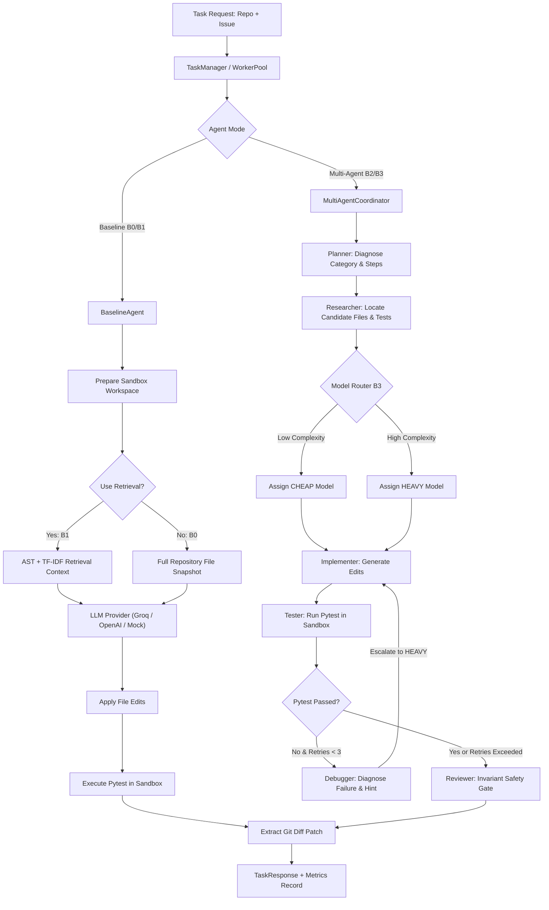

# RepoPilot — Architecture & Baseline Specification (Phase 1)

> **Document Version:** 1.0.0  
> **Phase:** 1 — Audit RepoPilot and Establish the Baseline  
> **Status:** Approved & Verified

---

## 1. System Overview & Current Codebase Audit

RepoPilot is an evaluation-driven coding-agent infrastructure designed to repair bugs in software repositories and scientifically measure the trade-offs of retrieval, multi-agent decomposition, dynamic model routing, and prompt caching.

### 1.1 Codebase Audit by Subsystem

| Subsystem | Components | Current State | Notes |
| :--- | :--- | :--- | :--- |
| **API** | `api/routes/tasks.py`, `dashboard.py`, `main.py` | **Complete** | Exposes `POST /tasks`, `GET /health`, `GET /metrics` (Prometheus), `GET /dashboard` (React SPA). |
| **Agents** | `agents/baseline/`, `agents/coordinator.py`, subagents (`planner`, `researcher`, `implementer`, `tester`, `debugger`, `reviewer`) | **Complete** | B0 Baseline (monolithic agent) and B2 Multi-agent coordinator with self-correction retry loop (max 3 retries). |
| **Retrieval** | `retrieval/ast/`, `graph/`, `embeddings/tfidf.py`, `indexer/`, `retriever.py` | **Complete** | AST code-entity parsing, import graph expansion, TF-IDF cosine retrieval with 8,000-character context budget. |
| **Inference** | `inference/models/`, `router/`, `cache/`, `telemetry/` | **Complete** | Groq & OpenAI OpenAI-compatible client, heuristic Mock provider, Dynamic model routing (CHEAP vs HEAVY), SHA-256 LRU+TTL prompt cache. |
| **Execution** | `execution/docker/sandbox.py`, `workers/pool.py`, `queue/manager.py` | **Functional (Needs Hardening)** | Supports local temp execution and Docker `python:3.11-slim` container runs. Concurrency worker pool. |
| **Evaluation** | `evaluation/datasets/`, `runner/`, `metrics/`, `experiments/` | **Prototype** | Tested on 20 synthetic seed tasks (`seed_tasks.json`). Needs real GitHub benchmark dataset. |
| **Observability** | `observability/telemetry.py`, `tracer.py`, `dashboard/` | **Complete** | Prometheus text exporter, subagent span tracer, and dark glassmorphic React dashboard. |
| **Tests** | `tests/test_*.py` | **Passing (30/30)** | Full coverage of API, baseline, benchmark metrics, multi-agent, router, cache, telemetry, and retrieval. |

---

## 2. Current Agent Workflow



---

## 3. Canonical Task Specification & Result Contracts

To guarantee that configurations **B0 (Baseline)**, **B1 (Retrieval)**, **B2 (Multi-Agent)**, and **B3 (Routing)** are evaluated identically without confounding variables, all configurations must adhere to uniform contracts.

### 3.1 Common Task Input Schema (`TaskSpec`)
```json
{
  "task_id": "click-pr-1234",
  "repository": "https://github.com/pallets/click",
  "base_commit": "a1b2c3d4e5f67890...",
  "issue_url": "https://github.com/pallets/click/issues/1230",
  "issue_description": "Command line options fail when passed unicode flags on Windows",
  "test_command": "pytest tests/test_options.py -k test_unicode_flags",
  "eval_command": "pytest tests/",
  "fail_to_pass": ["tests/test_options.py::test_unicode_flags"],
  "environment": {
    "python_version": "3.11",
    "dependencies": ["requirements-dev.txt"]
  }
}
```

### 3.2 Common Agent Output Schema (`TaskResult`)
```json
{
  "task_id": "click-pr-1234",
  "configuration": "b3_routing",
  "model_tier": "cheap",
  "model_identifier": "llama-3.1-8b-instant",
  "success": true,
  "patch": "diff --git a/src/click/core.py b/src/click/core.py\n...",
  "tests_passed": 1,
  "tests_failed": 0,
  "wall_time_seconds": 4.12,
  "queue_latency_seconds": 0.003,
  "tokens_input": 3200,
  "tokens_output": 450,
  "tokens_saved": 4800,
  "cost_dollars": 0.00028,
  "llm_calls": 2,
  "tool_calls": 3,
  "retries": 1,
  "failure_category": null,
  "error": null
}
```

---

## 4. Supported Environment & Language

- **Primary Language:** Python (3.10 and 3.11).
- **Test Runner:** `pytest`.
- **Target Repositories:** Small-to-medium pure Python libraries (< 5,000 lines of core code, e.g., `click`, `attrs`, `more-itertools`, `tinydb`, `boltons`, `humanize`).

---

## 5. Task Resource Budgets & Constraints

Every task execution attempt is strictly governed by deterministic resource limits:

| Resource | Hard Limit | Enforcement Point |
| :--- | :--- | :--- |
| **Max Wall Time** | 300 seconds (5 minutes) | Benchmark runner timeout monitor |
| **Max Model Calls** | 10 LLM invocations | Protocol coordinator counter |
| **Max Repair Retries** | 3 feedback iterations | Implementation-tester loop |
| **Sandbox Exec Timeout** | 60 seconds per test run | `subprocess.run(timeout=60)` |
| **Sandbox Memory Limit** | 2.0 GB RAM | Docker container limit |
| **Sandbox CPU Limit** | 2.0 vCPUs | Docker container limit |
| **Network Access** | Disabled (`--network none`) during evaluation | Container network policy |

---

## 6. Recorded Benchmark Decisions

### Decision 1: What counts as a successful fix?
A task is verified as **SUCCESSFUL (`success = True`)** if and only if all of the following conditions hold:
1. **Pre-fix verification:** The regression test fails on the unpatched base commit.
2. **Patch validity:** The agent generated a non-empty, syntactically valid patch (`git apply` cleanly succeeds).
3. **No test file tampering:** The patch alters **only source code files**; zero lines in test files (`tests/`, `test_*.py`) may be touched or deleted.
4. **Regression test passes:** The specific fail-to-pass test(s) pass cleanly.
5. **No regressions:** All existing pre-fix passing tests in the repository continue to pass.

### Decision 2: Model providers and model identifiers supported
To ensure reproducible cost accounting:
- **Groq:**
  - Heavy Tier: `llama-3.3-70b-versatile` ($0.59 / $0.79 per 1M tokens)
  - Cheap Tier: `llama-3.1-8b-instant` ($0.05 / $0.08 per 1M tokens)
- **OpenAI:**
  - Heavy Tier: `gpt-4o` ($2.50 / $10.00 per 1M tokens)
  - Cheap Tier: `gpt-4o-mini` ($0.15 / $0.60 per 1M tokens)
- **Mock Provider:** Deterministic offline regex engine ($0.00 cost) for CI smoke testing and development without network or API tokens.

### Decision 3: Cost and wall-time measurement policy
- **Cost:** Sum total of all token usage (prompt + completion) across all subagent steps (Planner, Researcher, Implementer, Debugger, Reviewer, and Routing calls).
- **Wall Time:** Real elapsed time starting from workspace checkout initialization through sandbox test completion, patch extraction, and cleanup. Queue wait time is tracked separately as `queue_latency_seconds`.

### Decision 4: Permitted actions in sandbox
- Reading source code files and directory listings.
- Modifying files inside the checked-out repository root only.
- Executing `pytest` via the isolated test runner.
- **Forbidden:** Access to host environment variables, network sockets during evaluation, Docker daemon socket, or files outside the sandbox directory.

### Decision 5: Features intentionally out of scope for v0.1
- Polyglot repository evaluation (JavaScript/TypeScript, Go, Rust, C++).
- Multi-repository tasks or monorepo cross-package dependency resolution.
- Interactive terminal sessions or GUI testing.
- Autonomous web browsing or internet package retrieval during evaluation.

---

## 7. Known Gaps & Implementation Priorities for Phase 2

1. **Dataset Mining & Verification (Top Priority):**
   - Current benchmark relies on synthetic in-memory tasks (`seed_tasks.json`).
   - Need to construct `dataset/` containing 3 real pilot GitHub tasks with pinned base and fix commits.
   - Build automated task verification script (`dataset/verification.py`) to verify fail-to-pass ground truth.
2. **Evaluation Boundary Hardening:**
   - Keep authoritative evaluation test suites in a read-only directory separate from the agent's writable workspace to make test tampering physically impossible.
3. **Standardized Benchmark CLI (`repopilot-bench`):**
   - Provide a clean CLI runner accepting `--dataset`, `--agent (b0|b1|b2|b3)`, `--model`, and `--out`.
